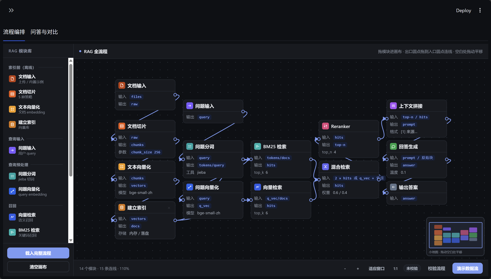
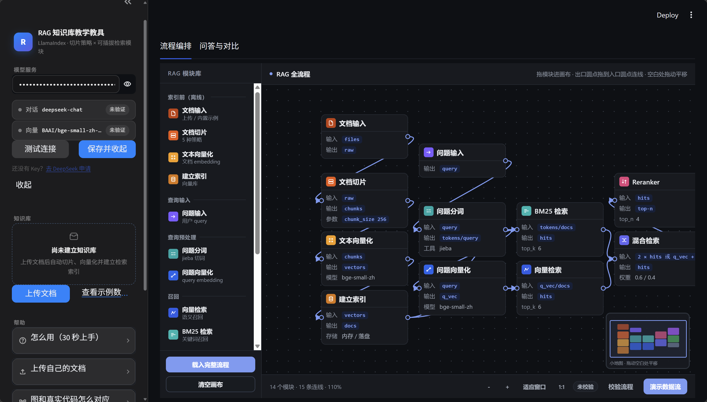
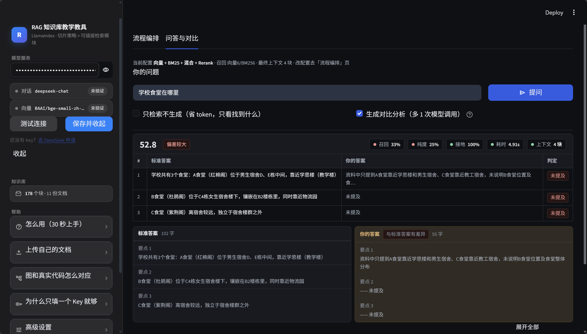

# RAG 知识库教学教具

一个可以**亲手拆装 RAG** 的沙盒。基于 **LlamaIndex**，国内镜像一键安装。

它不追求"答得好"，它追求"让你看清答案是怎么变好或变坏的"：

- **索引前**：换一种切片方式 → 立刻看到块数、块长、块边界怎么变
- **索引后**：拔掉一个检索模块 → 立刻看到召回结果和最终答案怎么崩
- **全程可见**：每一块召回、每一次重排、每一条喂给模型的原文都摊在屏幕上

---

## 为什么会有这个项目

起因很朴素：在准备阿里云 **ACA-LLM（大模型工程师助理级）认证**的时候，我和身边一起
备考的朋友撞上了同一堵墙 —— 课程把 RAG 的原理讲清楚了，但真要自己搭一条出来，完全是另一回事：

- **搭建流程太繁琐**：切片、向量化、建索引、召回、重排、拼接……每个环节都要自己找库、
  拼代码、调参数，光是把链路跑通就要耗掉好几个晚上，还常常卡在环境上
- **找不到趁手的工具**：现成的要么太重（一上来就是一整套平台，看不到内部），
  要么太散（每个环节一个 Notebook，看完仍然拼不出全貌），没有一个是为"学习"而做的
- **看不出每个节点到底在干嘛**：这是最关键的。教材会告诉你 Rerank 能提升效果，
  但没有任何东西能让你亲手把它拔掉、立刻看到答案是怎么崩的

所以这个工具就是照着这三个痛点做的：把整条 RAG 流水线摊成一张能拖能连的画布 ——
**画布上有什么模块，就跑什么流程；删掉哪个模块，就等于关掉哪个功能**。
它不追求把答案答得更好，它追求让你看清答案是怎么变好或变坏的。

如果你也在学 RAG、也在准备类似的认证，希望它能帮你省下那几个晚上。

---

## 界面一览

**流程编排**：整条 RAG 流水线是一张可拖拽的画布 —— 左侧模块库拖进来、连线决定数据流，「画布即配置」：



**侧栏 + 画布**：左侧是模型服务与语料管理（配好 Key 测试连接后可整体收起），右侧画布随时铺满全屏：



**问答与对比**：提问后直接看到「你的答案 vs 标准答案」的逐要点判定与差异对照，上方是召回覆盖率 / 上下文纯度 / 答案接地率三个质量分：



---

## 三步开始用

### 1. 克隆仓库

```powershell
git clone https://github.com/Rhine9527123/RAG-Learning-platform.git
cd RAG-Learning-platform
```

> 想换成本地别的目录名也行：`git clone <地址> RAG教学教具`，然后 `cd RAG教学教具`。

### 2. 启动前端（三种方式，任选一种）

#### 方式 A：双击 `启动.bat`（Windows 最省事）

首次启动会自动做完所有准备工作：

- 创建虚拟环境 `.venv`，用**清华镜像**装依赖（约 2 分钟）
- 从 **hf-mirror.com** 下载本地向量模型 `bge-small-zh-v1.5`（90MB，约 40 秒）
- 打开浏览器 `http://localhost:8501`

之后再启动就是秒开。

> 唯一前提：本机装了 Python 3.10+。`.bat` 会自动检测，没装会给出下载链接。

#### 方式 B：命令行启动（Windows，适合要改代码的人）

在 **PowerShell** 里依次执行（第 2、3 行只在首次需要）：

```powershell
cd RAG-Learning-platform
python -m venv .venv
.\.venv\Scripts\python.exe -m pip install -r requirements.txt -i https://pypi.tuna.tsinghua.edu.cn/simple
.\.venv\Scripts\python.exe -m streamlit run app.py
```

在 **CMD（传统黑框）** 里命令完全一样，但**不要把 `#` 开头的注释一起粘进去**——CMD 不认 `#`，会报「'#' 不是内部或外部命令」。

> 镜像超时怎么办：把 `-i` 后面换成下面任意一个，或直接双击 `安装依赖.bat`（它会按同样顺序自动依次尝试，某个源超时就换下一个，装完还会自检依赖能否导入）。
>
> - 阿里云 `https://mirrors.aliyun.com/pypi/simple`
> - 腾讯云 `https://mirrors.cloud.tencent.com/pypi/simple`
> - 华为云 `https://repo.huaweicloud.com/repository/pypi/simple`
> - 中科大 `https://mirrors.ustc.edu.cn/pypi/simple`
> - 官方 `https://pypi.org/simple`

也可以直接跑 `.\run.ps1`（与双击 `启动.bat` 等价）。

#### 方式 C：命令行启动（macOS / Linux）

```bash
cd RAG-Learning-platform
python3 -m venv .venv
source .venv/bin/activate
pip install -r requirements.txt -i https://pypi.tuna.tsinghua.edu.cn/simple
streamlit run app.py
```

第 2 到 4 行只在首次需要，之后每次只要最后一行。

默认监听 `8501`，浏览器会自动打开 `http://localhost:8501`。首次建库会自动从 `hf-mirror.com` 下载本地向量模型（约 90MB，只此一次），之后完全离线可用。

### 3. 在浏览器里粘贴 API Key

浏览器会自动打开 `http://localhost:8501`。左侧**只有一个输入框**：

- 粘一个 API Key（DeepSeek / 硅基流动 / 通义 / 智谱 任意一家都行）
- **接口地址、对话模型、向量模型全部预置好，不需要任何其他动作**
- 连「保存」都可以不点，直接开始建库

> **一个 Key 都没有也能玩。** 向量模型跑在本机，所以建库和检索完全不需要 Key，
> 只有"生成答案"那一步才需要。五种切片、四个检索模块照样能全部玩一遍。

### 附：常用启动命令

下面三条不含注释，PowerShell 和 CMD 里都能直接粘：

```powershell
.\.venv\Scripts\python.exe -m streamlit run app.py --server.port 8502
.\.venv\Scripts\python.exe -m streamlit run app.py --server.headless true
.\.venv\Scripts\python.exe -m streamlit version
```

- 第一行：8501 被占用时换端口
- 第二行：不自动打开浏览器（服务器 / 远程桌面）
- 第三行：确认环境装好了

macOS / Linux 把 `.\.venv\Scripts\python.exe -m streamlit` 换成 `streamlit` 即可。

> 改完 `config.py`、`ui/theme.py`、`ui/tab_qa.py` 这类被 import 的模块，Streamlit 的热重载不一定生效，**必须 Ctrl+C 停掉再重跑启动命令**，否则看到的是旧页面。
> 浏览器端如果样式没变，按 `Ctrl+F5` 强刷一次（CSS 会被缓存）。

---

## 两个功能页

| 页面 | 做什么 |
| --- | --- |
| **流程编排** | 一张可拖拽的画布 = 整条 RAG 流水线：选文档 → 选切片策略 → 拖模块连线 → 建立索引 → 按图执行。画布上有什么模块，就跑什么流程（**画布即配置**） |
| **问答与对比** | 提问 → 答案 + 喂给模型的原文 + 完整 prompt；**自动跑一次「完美检索」当参照，给出理想答案和三个质量分数** |

流程编排页把原来分散的「建库与切片」「检索模块」合并成一张图：

- 点「文档输入 / 文档切片」模块 → 选语料、选切片策略、预览切片、建立索引
- 拖进「向量检索 / BM25 / 混合检索 / Reranker / 上下文拼接」→ 连线决定数据怎么流
- **删掉哪个模块，就等于关掉哪个功能** —— 比如拔掉「上下文拼接」，模型就直接面对没有编号、没有来源的原始块
- 混合检索支持两种画法：拆开画（问题分词→BM25、问题向量化→向量检索→混合检索），或黑盒画（问题向量化 + 建立索引 直接接混合检索）

---

## 五种切片策略（对应五个 NodeParser）

内置 **11 份深圳信息职业技术大学校园指南**（新生入学 / 教学 / 生活 / 奖助 / 医疗 / 运动 / 宿舍 / FAQ / 数字表 / 学院专业 / 收费，约 3.3 万字），
按**版式**归到最适合的切片策略下 —— 这是刻意设计的：**用错切片方式，检索质量会肉眼可见地变差。**

选校园语料还有个额外好处：**内容学员本来就熟悉**，答案里一旦出现幻觉，一眼就能看出来。

| # | 策略 | 底层工具 | 推荐语料 | 适合什么 | 什么时候会失效 |
| --- | --- | --- | --- | --- | --- |
| 1 | Token 切片 | `TokenTextSplitter` | 二级学院与专业详解（608 行）+ 新生入学 | 版式平坦、没有小标题的长篇正文 | 会把一句话、一个论述从中间切断 |
| 2 | 句子切片 | `SentenceNodeParser`（本项目基于 `NodeParser` 补的） | 高频问答 FAQ（50 组 Q&A）+ 数字与时间表 | 每条信息自足，不依赖上下文 | 遇到「它」「该措施」「上面的方案」就失去主语 |
| 3 | 句子窗口 | `SentenceWindowNodeParser` | 教学 + 运动 + 宿舍（规章条款互相引用） | 句子间强依赖，指代多 | 索引体积变大；窗口太大会退回暴力切片 |
| 4 | 语义切片 | `SemanticSplitterNodeParser` | 生活日常 + 安全医疗（主题一路跳转） | 主题频繁转折但没有任何标题 | 每句都要调 embedding，最慢最贵 |
| 5 | Markdown 切片 | `MarkdownNodeParser` | 二级学院（102 个标题）+ 奖助 + 收费 | 作者已经用 `#` 分好段的文档 | 文档没标题就彻底失效（退化成整块） |

界面上每个策略都写清了 **适合 / 为什么 / 失效场景**，不用记。

---

## 四个可插拔检索模块

| 模块 | 底层工具 | 一句话原理 | 关掉会怎样 |
| --- | --- | --- | --- |
| **向量检索** | `VectorIndexRetriever` | 语义编码后按余弦相似度召回 | 失去同义改写能力，「充电充不进去」查不到「充不进电」 |
| **BM25** | `BM25Retriever`（+ jieba 中文分词） | 词频 × 逆文档频率 | 型号、错误码、数字只能靠向量碰运气 |
| **混合检索** | `QueryFusionRetriever`（RRF） | 两路各召回一批，按**排名**融合 | 单通道漏了就彻底漏了 |
| **Rerank** | `LLMRerank` | LLM 逐块判断"是否真的含答案"后重排 | 上下文由相似度分数决定，容易混进「字面像但没用」的块 |

模块之间有依赖关系，界面上会实时提示（比如：关掉向量后，混合检索会自动降级并告诉你）。

---

## 检索质量诊断：改完参数，怎么知道变好了还是变坏了

这一屏是整个教具的**反馈闭环**。每次问答后会额外跑一次「完美检索」当参照物，
然后给出三个可以横着比的分数：

| 指标 | 含义 | 这个分低说明什么 |
| --- | --- | --- |
| **召回覆盖率** | 该拿到的资料里，有多少真的进了上下文 | **缺料** —— 答案必然不完整，再好的模型也补不回来 |
| **上下文纯度** | 上下文里真有用的块占多少 | **噪声** —— 无关块会稀释重点、把模型带偏 |
| **答案接地率** | 答案里的数字/型号/百分比，有多少能在上下文中逐字找到 | **模型在编** —— 幻觉最直接的信号 |

三者放一起就能定位病因：

- 召回低、纯度也低 → 检索整个跑偏了，先回去改切片方式
- 纯度高、召回低 → 找得准但找得少，把 `Rerank 后保留数` 调大
- 两个都高、接地率低 → 料给对了，是模型没用好上下文（试 `temperature` 或换模型）

### 理想答案是什么

不是让模型凭记忆瞎答，而是**把召回范围放到最大**（向量 20 + BM25 20 + RRF 融合 12，
不截断、不重排），用这批"近似完整"的资料重新生成一遍。它代表"如果检索器不犯错，
本来应该得到的答案"。所以对照它，能直接看出是**检索丢了料**还是**模型没用对**。

> 成本：每问一次多 1 次模型调用（约 3k token）。页面上可以关掉，
> 关掉后仍会显示召回/纯度两个集合类指标（零成本、确定性）。
> 如果模型返回的不是合法 JSON，会自动退化成「宽召回全集」估算，并在页面上标注。

### 实验记录带分数

页面底部的实验记录表格会带上这三列 + 综合分。**改完参数再问同一个问题**，
直接从「综合」这一列看它涨了还是掉了 —— 这就是"改了不同参数有没有用"的答案。

---

## 推荐做的 6 个实验

做完这 6 个，RAG 的主要坑你基本都踩过一遍了。

1. **切片对照**：同一份文档，分别用第 1 / 3 / 4 / 5 种策略预览，看「块数 / 平均块长 / 最长最短」四个数字怎么跳
2. **失效现场**：把「FAQ 速查表」硬套第 1 种 Token 切片，看一条问答被从中间切开后长什么样
3. **BM25 高光**：搜 `XHC-100A` 或 `42902`，对比开 BM25 前后召回结果 —— 精确 token 是 BM25 的主场
4. **Rerank 显形**：搜一个语义模糊的问题，对比 Rerank 前后的顺序变化（常常差很远）
5. **混合 vs 拼接**：关掉「混合检索」但保留向量+BM25，对比"RRF 融合"和"直接拼接"的差别
6. **上下文污染**：把「Rerank 后保留数」拉到 10，看「上下文纯度」这个分怎么掉

每次问答都会自动记进「实验记录」，同一问题不同配置可以并排看，**每行都带三个诊断分数**。

---

## 支持的模型供应商

全部走 **OpenAI 兼容协议**，选一个粘 Key 即可：

| 供应商 | 对话模型 | 云端 Embedding |
| --- | --- | --- |
| 硅基流动 SiliconFlow | 支持 Qwen / DeepSeek-V2.5 | 支持 BAAI/bge-m3 |
| 阿里百炼 DashScope | 支持 qwen-plus / max | 支持 text-embedding-v3 |
| 智谱 BigModel | 支持 glm-4-flash / plus | 支持 embedding-3 |
| DeepSeek | 支持 deepseek-chat / reasoner | 不支持 |
| 月之暗面 Moonshot | 支持 moonshot-v1 | 不支持 |
| OpenAI | 支持 | 支持 |
| 自定义 | 任何 OpenAI 兼容端点 | 同 |

### 但 Embedding 默认不走云端

**向量模型默认在本机跑**（`fastembed` + `BAAI/bge-small-zh-v1.5`，90MB / 512 维），
所以：

- 你只需要一个对话模型的 Key（DeepSeek、Moonshot、随便哪家都行）
- **甚至完全不填 Key 也能建库和检索** —— 向量在本地算，只有"生成答案"需要 Key
- 模型走 `hf-mirror.com` 镜像下载，一次下完永久离线可用

想改用云端 embedding（或换更大的本地模型），展开左侧「高级设置 → 向量来源」即可。

| 本地模型 | 体积 | 维度 | 适用 |
| --- | --- | --- | --- |
| `BAAI/bge-small-zh-v1.5` | 90MB | 512 | 默认档，速度最快 |
| `jinaai/jina-embeddings-v2-base-zh` | 640MB | 768 | 中文长文本（8K），块切得很大时更合适 |
| `paraphrase-multilingual-MiniLM-L12-v2` | 220MB | 384 | 中英混排文档 |

---

## 项目结构

```
启动.bat               双击即启动（自动装依赖 + 下模型 + 开浏览器）
安装依赖.bat           只装依赖（6 个镜像自动回退 + 装完自检），双击即可
app.py                 入口（两个 tab：流程编排 / 问答与对比）
config.py              供应商预设 + 五种切片策略的元数据 + 模块文案
.streamlit/config.toml 亮/暗两套主题色 —— 全项目唯一的色值定义点
core/
  chunking.py          五种切片策略（+ 中文分句器）
  ingest.py            文档解析（txt/md/pdf/docx）
  llm.py               OpenAI 兼容模型工厂 + 连通性自检
  kb.py                建索引 / 持久化 / 加载
  retrievers.py        四个可插拔检索模块 + 检索过程追踪
  evaluate.py          检索质量诊断（理想答案 + 三个分数 + 参数建议）
  pipeline.py          拼 prompt + 生成答案
ui/
  theme.py             设计令牌 + 全局样式 + 六态视图（纯视觉层，不含业务）
  sidebar.py           API Key 快捷接口（模型服务 / 语料 / 帮助）
  tab_flow.py          流程编排页：画布 → 配置 → 建库 → 执行
  tab_qa.py            问答 + 实验对比
  flow_component/      画布前端组件（index.html，纯 HTML/JS，无构建步骤）
data/
  samples/             11 份内置语料（深信大校园指南）
  models/              本地向量模型缓存（首次自动下载，可删）
  storage/             索引持久化（重建即可，可删）
docs/screenshots/      README 用的界面截图
```

**教学向的设计选择**：`config.py` 里集中存放所有"解释性文案"，业务代码里不夹带；
`ui/` 只调用 `core/`，不写业务逻辑。改文案不用碰逻辑。

---

## 五个真实的坑（本项目都已修，值得知道）

这些坑会让你以为"RAG 就是这样"，其实只是没配好。

### 1. BM25 在中文上默认是坏的

`llama_index.retrievers.bm25.BM25Retriever` 用 `token_pattern=r"(?u)\b\w\w+\b"` 切词。
unicode 下 `\w` 匹配中文，而**中文句子没有空格** —— 于是整句话被当成一个 token，
BM25 退化成"按整句精确匹配"，分数几乎全是 0。

本项目用 `ChineseBM25Retriever` 子类化官方实现：建索引和检索前都先用 jieba 分词，
节点正文原样保留。试一下搜 `XHC-100A`，能明显看出差别。

### 2. 语义切片默认用英文分句器

`SemanticSplitterNodeParser` 的 `sentence_splitter` 默认是 `SentenceSplitter`（按 token 开窗）。
几百字的中文会被它当成"**一个句子**"，于是永远算不出断点，整篇切一块 —— 看起来像"语义切片没用"。

本项目显式传入中文分句函数 `split_sentences_zh`。修完之后：阈值 95 / 90 / 80 分别切出
4 / 6 / 10 块，方向完全符合预期。

### 3. `SentenceWindowNodeParser` 的 `window_size` 不能为 0

想做"纯句子切片"（一句一节点）时会卡在这：`window_size` 强制 ≥ 1，必然带上下文。
官方也没有提供"一句一节点"的 parser。本项目基于官方 `NodeParser` 抽象补了一个
`SentenceNodeParser`，只做一件事：按中文句末标点切开，每句一个标准 `TextNode`。

顺带一提，`split_sentences_zh` 刻意**不把英文句点当句末**，否则 `9.9 元`、`v2.0`
会被切成两半。

### 4. 下载模型时 hf-mirror 会 401

新版 `huggingface_hub` 默认走 **Xet** 存储协议（`cas-server.xethub.hf.co`），
而 `hf-mirror.com` 没有实现 Xet，于是下载直接报
`401 Unauthorized, domain: https://cas-server.xethub.hf.co/...`。

解法是强制退回普通 CDN：`HF_HUB_DISABLE_XET=1`。本项目在 `core/llm.py`
的 `_prepare_hf_env()` 里设好了三个环境变量（`HF_ENDPOINT` / `HF_HUB_DISABLE_XET`
/ `HF_HUB_ENABLE_HF_TRANSFER`），下载 90MB 模型实测约 40 秒。

### 5. llama-index 0.14 会用 OpenAI 白名单卡住国内模型名

`llama_index.llms.openai.OpenAI` 构造时要拿模型名去 `ALL_AVAILABLE_MODELS`
查上下文长度，而 `deepseek-chat` / `qwen-plus` / `glm-4-flash` / `moonshot-v1-8k`
全都不在这个白名单里，于是直接抛：

```
ValueError: Unknown model 'deepseek-chat'. Please provide a valid OpenAI model name in: o1, o1-2024-12-17, ...
```

**任何国内模型都会中招**，而且错误信息看起来像是"你模型名写错了"，特别有误导性。

解法：改用 `llama_index.llms.openai_like.OpenAILike` —— 官方专门为
「OpenAI 兼容服务」准备的类，不做这个白名单校验，上下文长度由我们自己按供应商
声明（见 `config.py` 里每家配的 `context_window`）。

---

## FAQ

**索引会不会每次启动都重建？**
不会。索引持久化在 `data/storage/<kb_id>/`，重建时原地覆盖。但换了向量模型必须重建
（向量维度不同）—— 界面上会直接拦住并提示。

**为什么我的知识库加载不了？**
`meta.json` 里记了建立时的向量模型和来源（本地/云端），和当前配置不一致就拒绝加载。
点「重建索引」即可。

**语义切片为什么这么慢？**
它要给每一句话都算一次 embedding。一份 2000 字的文档大约 100 句。这是它的固有成本，
也正是它"最贵"的原因 —— 本地模型只是省了 API 费用，计算量一点没少。

**本地向量模型会不会很吃性能？**
`bge-small-zh` 是 512 维的小模型，CPU 上单条编码约几毫秒，教学规模的建库是秒级。
它不需要 GPU、不需要 torch（后端是 onnxruntime），内存占用约 200MB。

**模型下载卡住 / 失败怎么办？**
代码里已经写死 `HF_ENDPOINT=https://hf-mirror.com` 且设置了 `HF_HUB_DISABLE_XET=1`
（新版 huggingface_hub 默认走 Xet 协议，而 hf-mirror 不支持，会直接 401）。
如果还是失败，重新点一次「建立索引」会断点续传。

**API Key 存在哪？**
`data/settings.json`（已在 `.gitignore` 里）。明文存在你自己机器上，不会上传。
对话请求直接发往你选的厂商，向量计算完全在本机。
